::: {layout="[10,-2,30]" layout-valign="center"}
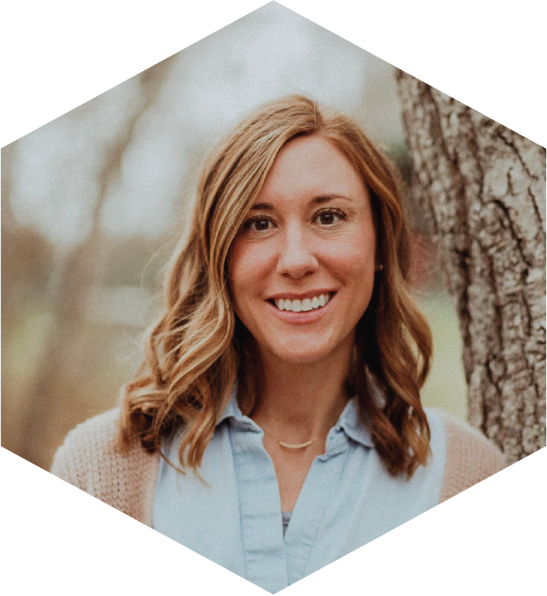

**Margaret (Maggi) Mars Brisbin** (she/her) is the PI of the MICOlab and an Assistant Professor at the University of South Florida's College of Marine Science. Maggi completed her Ph.D. at the Okinawa Institute of Science and Technology (Japan), where she worked under Prof. Satoshi Mitarai to comprehensively characterize the symbiosis between acantharian protists and the Haptophyte phytoplankton *Phaeocystis*. Side projects and ongoing interests from Okinawa include investigating how extreme storms and urbanization dimpact microbes in coastal ecosystems. Recent research focuses on positive and negative interactions between *Phaeocystis* and their colony microbiomes, and the impact these interactions may have on bloom formation in different regions. Maggi is passionate about science communication, outreach, and building an inclusive and supportive lab.    
:::

::: {layout="[10,-2,30]" layout-valign="center"}
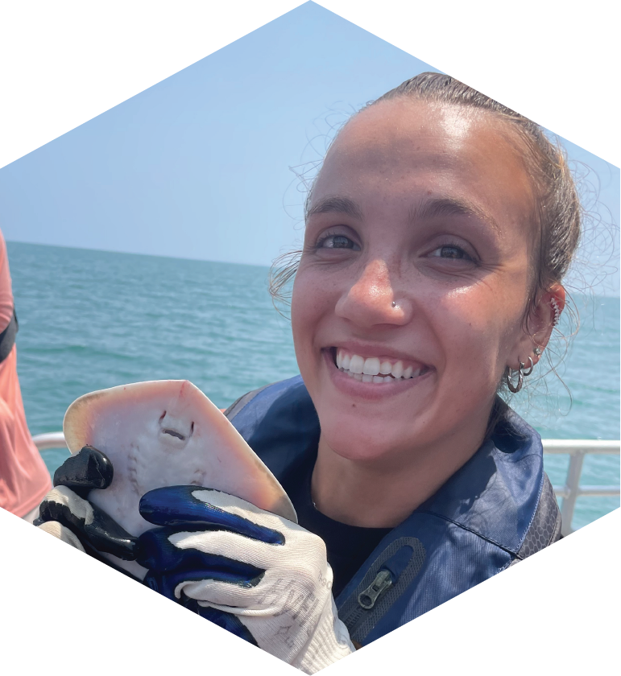

**Lilianna Giuffrida** joined the MICO lab as an M.Sc. student in the Fall of 2025. She is interested in how the dinoflagellate species *Pyrodinium bahamense* obtains vitamins in the waters of Old Tampa Bay. She is currently working on a project to identify the main source of vitamin B12 for *P. bahamense*. While also assisting with other ongoing projects, she is becoming well versed in microbiology and working with phytoplankton cultures. Lilianna loves the Florida manatees and wants to keep their habitat healthy - so it is important to monitor the microalgae that they share a home with! She is passionate about sustainability and conservation, and aims to pursue a career in algal biotechnology.  
:::

::: {layout="[10,-2,30]" layout-valign="center"}
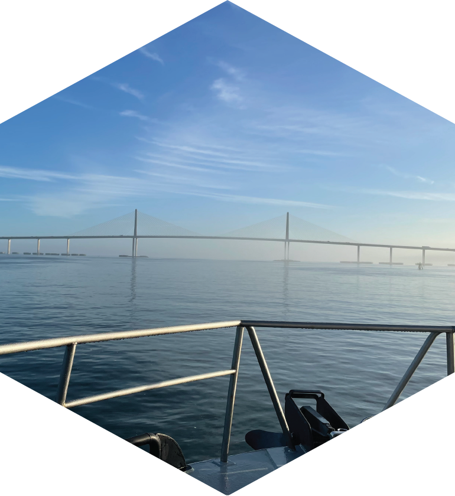

**Casey Breslow** joined the MICO lab as an M.Sc. student in the Summer of 2026. She is interested in how the phytoplankton community in the Southern Ocean shifts and responds to physicochemical changes, such as meltwater, sea ice concentration, and available nutrients. She is currently working on a project to identify the community composition in the summer months in the Weddell Sea, and determine if limiting nutrients include iron and/or B12. Outside of the lab, Casey enjoys cycling, scuba diving, and exploring the local area with her dog Pumpkin. She hopes to pursue a career that allows her to improve conservation methods, while exploring new places.   
:::

::: {layout="[10,-2,30]" layout-valign="center"}

**Emmaline Miller** joined the MICO lab as an M.Sc. student in the Fall of 2026. She is extremely interested in investigating how large-scale processes such as climate change impact small-scale organisms like plankton. She is currently studying the interactions between phytoplankton, bacteria, and the essential vitamin B12 in marine environments. In her free time, Emmaline loves to read, and explore any (and all) bodies of water. She aims to build a career that drives clear scientific understanding, and benefits the ocean that she loves so much.   
:::

::: {layout="[10,-2,30]" layout-valign="center"}
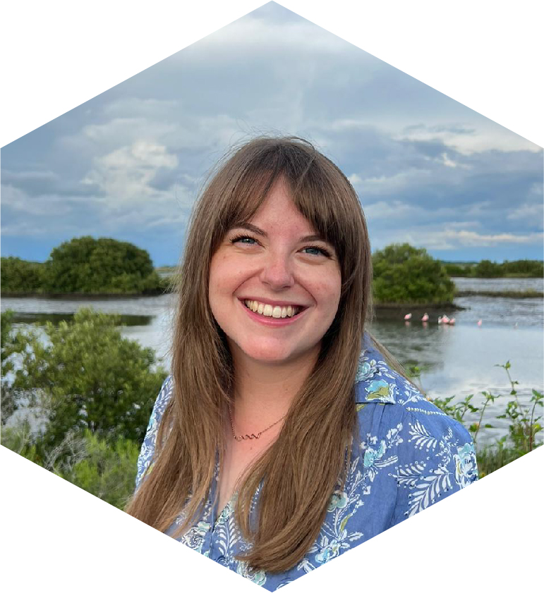

**Olivia Blondheim** transferred to the MICOlab in Fall 2024 to complete her dissertation research. Her project focuses on the water filtration services of the eastern oyster in Tampa Bay. She is measuring the water filtration rates of oysters on both natural (i.e., oyster reefs) and artificial (i.e., mangrove prop roots, vertical oyster gardens) substrates. She is also experimentally evaluating whether oysters can diminish the severity of harmful algal blooms in warming ocean conditions. When Olivia is not in the lab or the field, you can usually find her assembling vertical oyster gardens with the community at outreach events, advocating for sustainable aquaculture in D.C., or photographing wildlife at one of her favorite local parks.
:::

::: {layout="[10,-2,30]" layout-valign="center"}
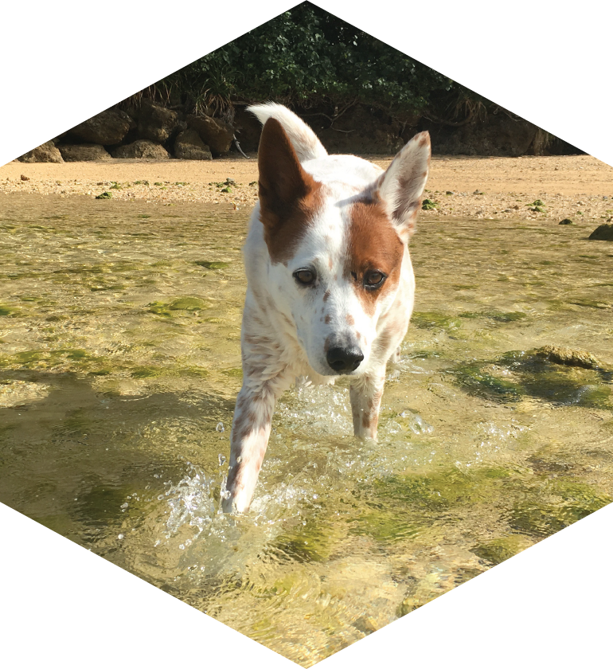

**Gnasher Brisbin** is a 15-year-old Australian Cattle Dog (Red Heeler) who is deeply interested in reef fish and sea cucumbers. He is currently studying the effect of loud noises (barking) on prey fish behavior. In his spare time, he enjoys sun bathing, walking, sleeping, and eating. He is the number one supporter of MICOlab publications being written.
:::

::: {layout="[10,-2,30]" layout-valign="center"}
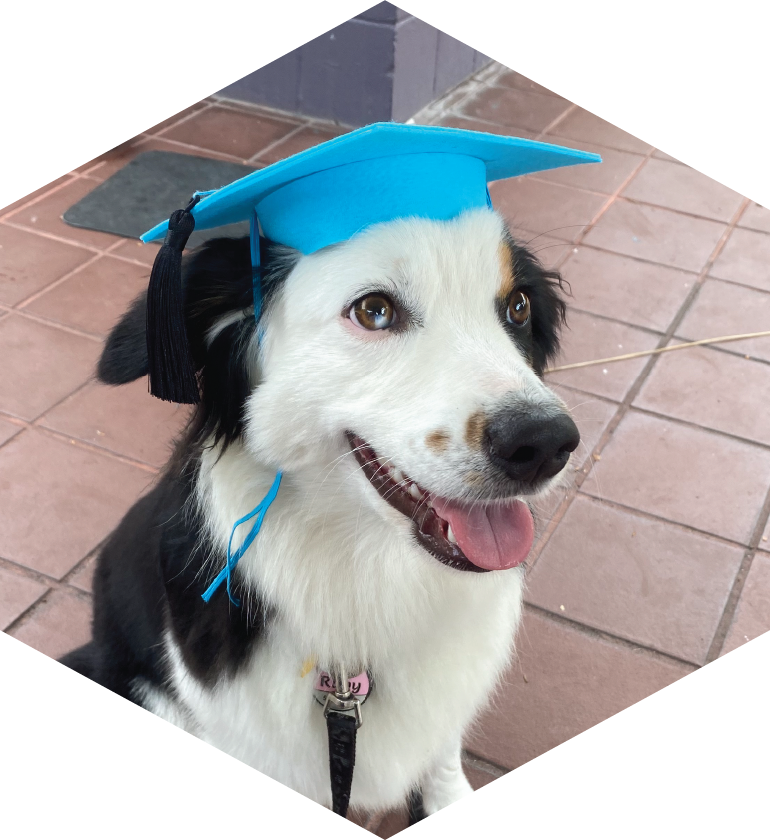

**Ruby Brisbin** is a mini American Shepherd (a.k.a. mini Aussie) puppy and recent addition to the MICOlab. She is still developing her academic interests, but is leaning towards terrestrial ecology as she is especially interested in the activity of native and invasive anoles in Florida. In her free time, she enjoys sailing, walking, running, jumping, and Frisbee.
:::

   

------------------------------------------------------------------------

 

*Past Members*

  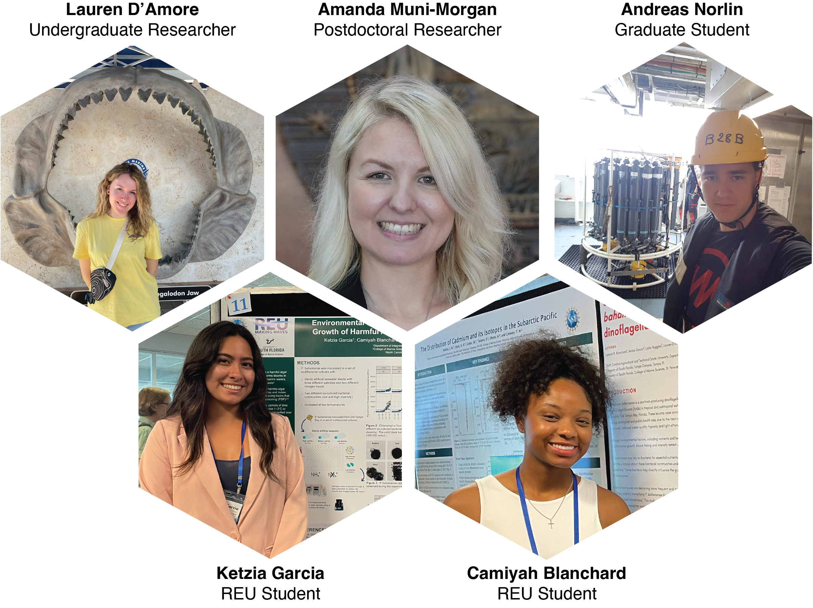{fig-align="center"}

 

------------------------------------------------------------------------

 

*Group Photos*

::: {fig-align="center"}
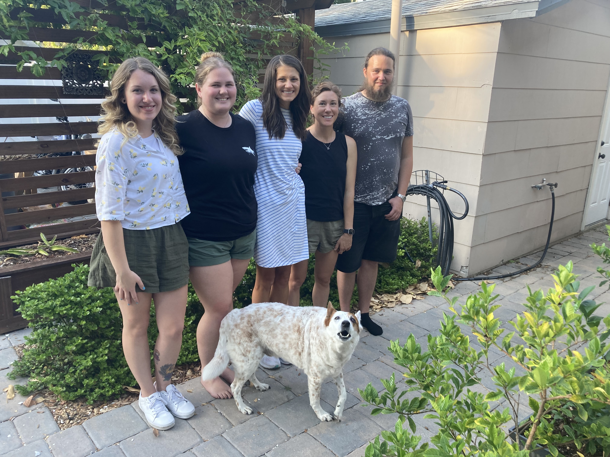{width="4in"}

**2024 - End of the Year BBQ.** *Clockwise from top left: Lauren, Abbey, Lydia, Maggi, Andreas, Gnasher.*
:::

::: {fig-align="center"}
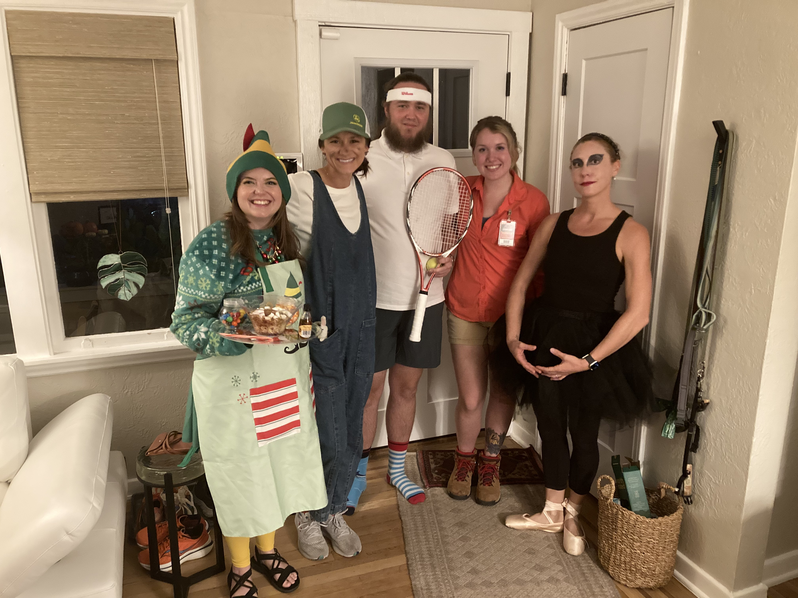{width="4in"}

**2024 - Halloween Party.** *From left: Elf (Olivia), Farmer (Lydia), Tennis Pro (Andreas), Jurassic Park's Dr. Ellie Sattler (Lauren), Black Swan (Maggi).*
:::

::: {fig-align="center"}
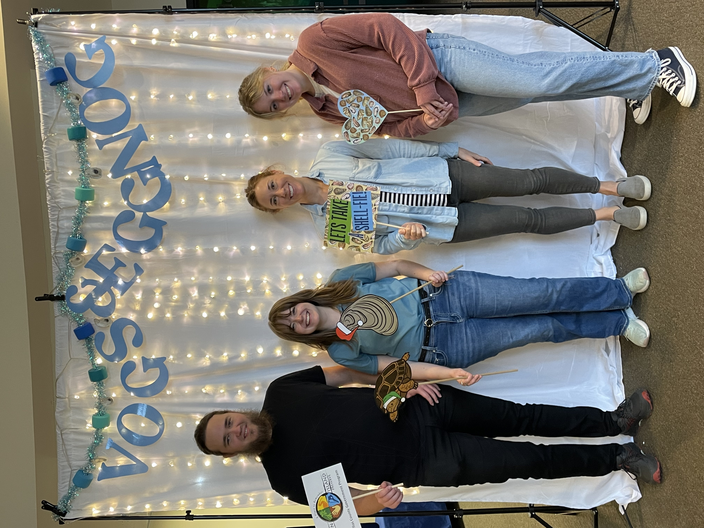{width="4in"}

**2024 - VOGs and Egg Nog outreach event planned and executed by Olivia.** *From left: Andreas, Olivia, Maggi, Lauren.*
:::

::: {fig-align="center"}
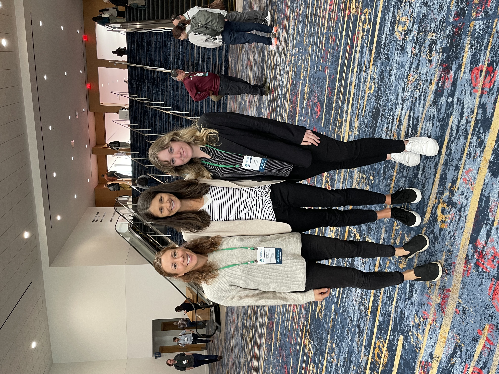{width="4in"}

**2025 - MICOlab at the ASLO Aquatic Sciences Meeting in Charlotte, North Carolina, March 26–31.** *From left: Maggi, Lydia, Lauren.*
:::

::: {fig-align="center"}
{width="4in"}

**2025 - MICOlab celebrating Lydia's successful master's thesis defense with dinner at Pia's.** *From left: Olivia, Lauren, Maggi, Lydia, Lilianna.*
:::

::: {fig-align="center"}
{width="4in"}

**2025 - MICOlab with friends and collaborators Hannah Reich and lab (SUNY ESF) at the South East Phycological Colloquy (SEPC) hosted at the VIMS Eastern Shore Lab.** *From left: Lilianna, Hannah, Maggi, Genevieve, Stephan.*
:::

::: {fig-align="center"}
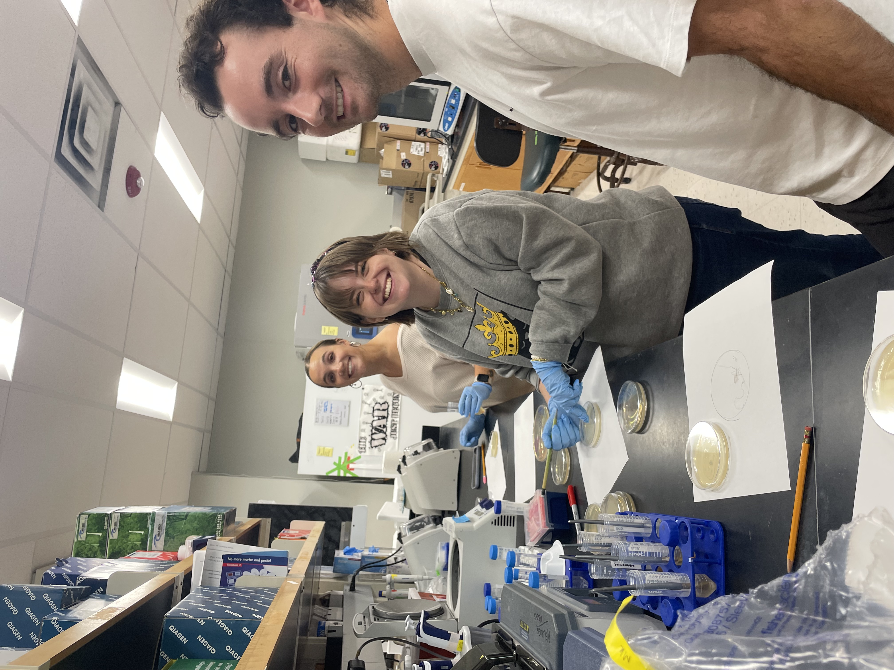{width="4in"}

**2025 - MICOlab painting neon bacteria artworks for Halloween lab meeting.** *From left: Lilianna, Olivia, Martin.*
:::
